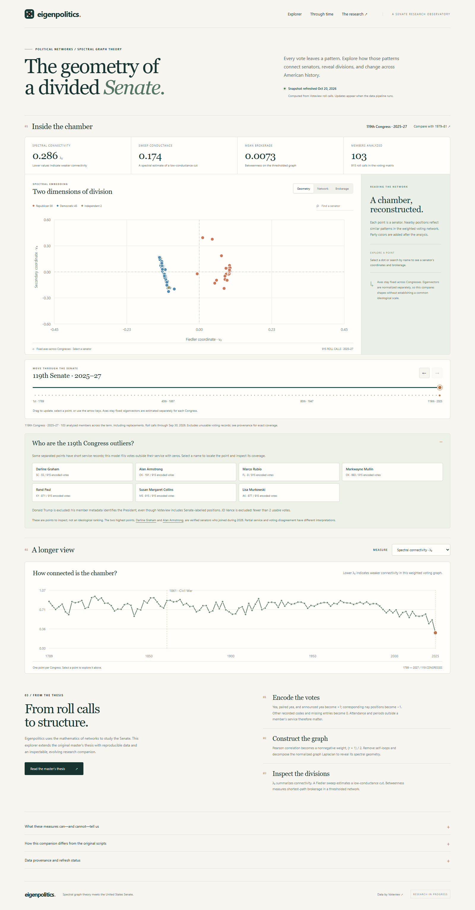
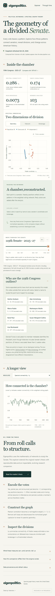
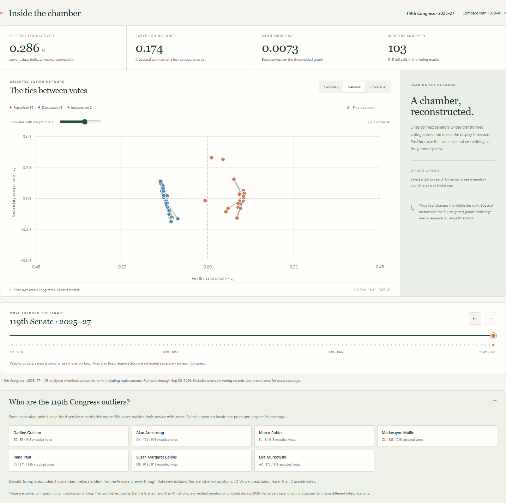
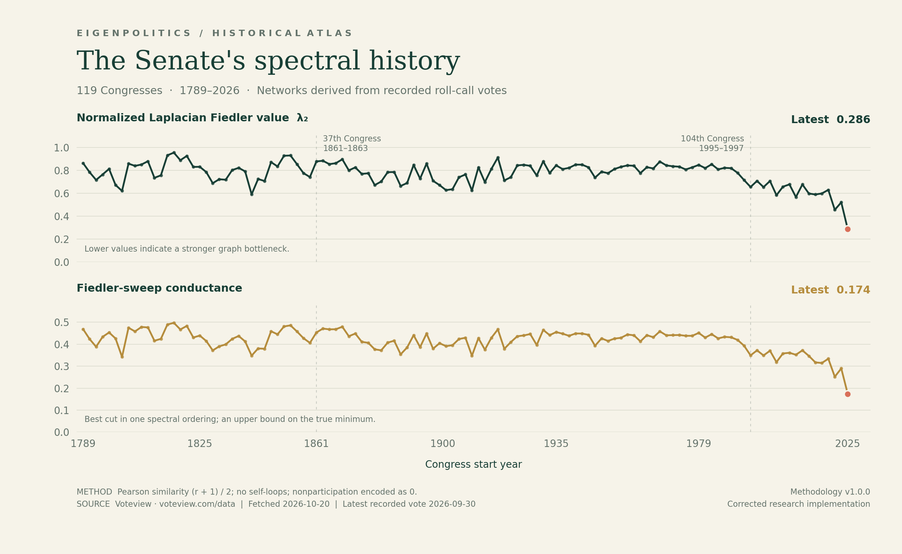
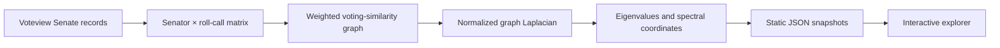

<div align="center">

# Eigenpolitics

### The shape of political division.

A research companion to **Eigen-Politics: A Spectral Analysis of the US Senate**  
**Maximilian Chelminski · Master's thesis · 2026**

[Read the thesis](<2026 Master's Thesis.pdf>) · [Explore the method](docs/METHODOLOGY.md) · [Run locally](#run-locally) · [Hosting guide](docs/DEPLOYMENT.md)

</div>



What can the geometry of Senate voting reveal about political division? Eigenpolitics turns roll-call records into a weighted network, then uses its graph Laplacian to examine connectivity, voting blocs, and the members positioned between them.

This repository brings together the original thesis and analysis scripts, an interactive research explorer, and a reproducible pipeline for refreshing the underlying Voteview data. It runs locally without a frontend build or account. An optional GitHub Pages workflow can publish the site and refresh its current-Congress analysis daily.

> **Research status:** The thesis and original scripts are preserved as supplied. The explorer is a maintained companion with refreshed inputs and documented implementation choices. Its results are **not an exact reproduction of the thesis's May 5, 2026 data snapshot**.

## Explore the research

| View | Research question |
| --- | --- |
| Historical comparison | How has the Senate's spectral connectivity changed across Congresses? |
| Spectral map | Which senators occupy similar positions in the voting network? |
| Network and brokerage views | Which strong voting ties and shortest-path bridge positions appear in the graph? |
| Congress detail | What do the eigenvalues and network statistics reveal about a selected Senate? |
| Member inspection | Where does a particular senator sit in that Congress's structure? |
| Source and method notes | What was downloaded, when was it retrieved, and how were the results computed? |

Drag the timeline beneath the chamber plot, select one of its Congress points, or use the arrow keys to move through all 119 Senates. The plot updates on input, with fixed axes across Congresses. Geometry and network views share the same limits; brokerage has its own fixed vertical scale. Independently estimated eigenvectors still do not form a shared ideological scale.

The 119th Congress also has named inspection shortcuts and a [source-level outlier audit](docs/DATA_AUDIT.md). Trump and Vance are excluded. Several striking points belong to real senators with partial-term records; zero-filled time outside service can create apparent separation, so the audit distinguishes that effect from observed voting disagreement.

<details>
<summary>See the mobile explorer and network view</summary>

<p align="center">
  
</p>



</details>

The screenshots show the actual local application. Data values can change after a refresh.

## Research figures



The repository includes reproducible, high-resolution [history](docs/images/spectral-history.svg) and [96th/119th Congress comparison](docs/images/spectral-comparison.svg) figures in PNG and SVG formats. These use the corrected companion pipeline and identify important limitations, including short-service records.

To regenerate them from the bundled JSON:

```bash
python -m pip install -e ".[figures]"
python scripts/render_figures.py --svg
```

## Run locally

**Requirements:** Python 3.11 or newer and a modern browser. No scientific packages are needed to view the included data.

From this repository's root:

```bash
python scripts/serve.py
```

Open **[http://127.0.0.1:4173](http://127.0.0.1:4173)**. Stop the server with `Ctrl+C`.

Windows convenience launcher:

```powershell
.\scripts\start.ps1 -OpenBrowser
```

If port 4173 is occupied, use `python scripts/serve.py --port 4174`. The server binds to your machine's loopback address and serves the `site/` directory.

### Keep the local data updating

After installing `requirements.txt`, start the optional refresh loop:

```bash
python scripts/serve.py --refresh-hours 6
```

Or on Windows:

```powershell
.\scripts\start.ps1 -Live -OpenBrowser
```

This refreshes the current Congress immediately in the background, then waits six hours between attempts while serving the site. It runs only while this process is running and the computer is awake. No system scheduled task is installed. A failed refresh is logged, and the server continues serving its available snapshot. Voteview's publication schedule can still lag the latest Senate activity.

## Refresh with current data

Install the analysis dependencies, then fetch and recompute the current Congress:

```bash
python -m pip install -r requirements.txt
python scripts/refresh_data.py --congress current --refresh
```

Reload the local site to see the updated snapshot. A virtual environment is recommended; [the development guide](docs/DEVELOPMENT.md) includes setup instructions.

Other useful commands:

```bash
# Rebuild the complete available history, reusing downloaded source files
python scripts/refresh_data.py

# Recompute a selection of Congresses
python scripts/refresh_data.py --congress 1 37 96 119

# Work only from previously cached downloads
python scripts/refresh_data.py --offline
```

The pipeline downloads Senate votes, members, and roll-call metadata from [Voteview](https://voteview.com/data). Source files are cached in `.cache/`; generated, browsable results are stored in `site/data/`. Refreshing one Congress retains the other generated Congresses.

**“Current” means the most recent successfully retrieved source snapshot.** The local browser does not directly stream Senate votes. Upstream publication and a successful pipeline refresh determine the available data; reload the page to check it immediately.

## From roll calls to a spectral map



The second-smallest eigenvalue, usually written **λ₂**, measures a form of graph connectivity. Smaller positive values can indicate a stronger bottleneck between groups. They do not by themselves prove literal disconnection, legislative paralysis, or a causal account of polarization.

Spectral coordinates summarize the voting graph within a Congress; they are not a universal left–right ideology scale. Their signs are mathematically arbitrary, and the companion documents its orientation convention. Attendance, abstention, changing agendas, membership turnover, and graph construction all affect interpretation.

Read [Methodology](docs/METHODOLOGY.md) for the vote encoding, exclusions, similarity transformation, Laplacian, centrality definitions, provenance, and limitations. Read [Thesis guide](docs/THESIS.md) for the original argument and the relationship between the archived work and the refreshed companion.

## What is in the repository

```text
eigenpolitics/
├── 2026 Master's Thesis.pdf       Original thesis
├── 2026 Master's Thesis.docx      Original editable manuscript
├── senate_clean.py               Original analysis script
├── senatelinearalgebra.py         Original analysis script
├── eigenpolitics/                Analysis, source validation, and CLI package
├── site/                         Static research explorer
│   ├── index.html
│   ├── styles.css
│   ├── app.js
│   ├── research/thesis.pdf        Unmodified copy for the site's thesis link
│   └── data/                     Versionable derived snapshots
├── scripts/
│   ├── refresh_data.py           Download and analyze Voteview inputs
│   ├── serve.py                  Local server; no extra dependencies
│   └── start.ps1                 Windows launcher
├── tests/                        Regression checks for the pipeline
├── docs/
│   ├── METHODOLOGY.md
│   ├── THESIS.md
│   ├── DATA_AUDIT.md              Named outliers, membership checks, and diagnostics
│   ├── DEVELOPMENT.md
│   ├── DEPLOYMENT.md
│   └── images/                   Application screenshots and figures
├── .github/workflows/            CI and optional Pages deployment
├── requirements.txt
└── CITATION.cff
```

## Host it later, without a domain

GitHub Pages can host this static site at a project address such as `https://<owner>.github.io/<repository>/`. A purchased domain is optional, and public repositories can use Pages on GitHub Free. See [GitHub's Pages documentation](https://docs.github.com/en/pages/getting-started-with-github-pages/what-is-github-pages).

The included publishing workflow is **disabled by a repository-variable gate** until you opt in. Once enabled, it refreshes the current and preceding Congresses, checks the pipeline, and deploys the site on a daily schedule as well as on pushes to `main`. Refreshing the preceding term also captures its final votes after a Congress rollover.

Follow [the deployment guide](docs/DEPLOYMENT.md) to publish and enable updates. The files in this repository do not themselves create a GitHub repository or a hosted site. Start the optional local refresh loop explicitly with `--refresh-hours`.

## Validation and contributions

```bash
python -m unittest discover -s tests -v
python -m compileall -q scripts eigenpolitics
node --check site/app.js
```

Node.js is optional for syntax checks and the Playwright browser checks; it is not required to run the site. See [Contributing](CONTRIBUTING.md) for research conventions and [Development](docs/DEVELOPMENT.md) for browser verification, screenshot regeneration, and troubleshooting.

## Citation and attribution

> Chelminski, Maximilian. 2026. *Eigen-Politics: A Spectral Analysis of the US Senate*. Master's thesis, Quantitative Methods in the Social Sciences, Graduate School of Arts and Sciences.

Machine-readable citation metadata is available in [CITATION.cff](CITATION.cff). Cite the thesis when discussing its research and cite Voteview separately when using the voting data. Include the Congress and retrieval date when reporting results from the refreshed companion.

Voteview's requested source citation is:

> Lewis, Jeffrey B., Keith Poole, Howard Rosenthal, Adam Boche, Aaron Rudkin, and Luke Sonnet. 2026. *Voteview: Congressional Roll-Call Votes Database*. [voteview.com](https://voteview.com/).

This project is not affiliated with or endorsed by Voteview or the United States Senate.

**Rights:** The original thesis and custom code are provided without a selected open-source license. Public visibility does not grant unrestricted reuse. The author can add an appropriate license before public release; third-party data remains subject to its own attribution and use terms.
