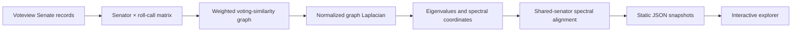

<div align="center">

# Eigenpolitics

### The shape of political division.

A research companion to **Eigen-Politics: A Spectral Analysis of the US Senate**  
**Maximilian Chelminski · Master's thesis · 2026**

[Explore online](https://maxchelminski.github.io/eigenpolitics/) · [Read the thesis](<2026 Master's Thesis.pdf>) · [Explore the method](docs/METHODOLOGY.md) · [Run locally](#run-locally)

</div>


Eigenpolitics is an interactive atlas of U.S. Senate voting networks across **119 Congresses**. It applies spectral graph theory to roll-call records to examine political division, network bottlenecks, and brokerage, with a reproducible Python pipeline and a browser-based explorer.

Developed from Maximilian Chelminski's 2026 master's thesis, the project brings the original research together with maintained analysis and interactive visualizations. Explore spectral geometry, follow returning senators through aligned maps, inspect voting ties, and trace results to their source data and methodology. It also runs locally without a frontend build or account.

The [online explorer](https://maxchelminski.github.io/eigenpolitics/) is configured for GitHub Pages, with automatic Voteview refreshes **every six hours**. These are periodically updated source snapshots; their freshness depends on upstream publication and successful refresh runs. [Deployment and refresh details →](docs/DEPLOYMENT.md)

> **Research status:** The thesis and original scripts are preserved as supplied. The explorer is a maintained companion with refreshed inputs and documented implementation choices. Its results are **not an exact reproduction of the thesis's May 5, 2026 data snapshot**.

## Explore the research

| View | Research question |
| --- | --- |
| Historical comparison | How has the Senate's spectral connectivity changed across Congresses? |
| Geometry | Which senators occupy similar positions in the original spectral map? |
| Aligned spectral map | How do senators' positions in the voting network change relative to continuing colleagues? |
| Network and brokerage views | Which strong voting ties and shortest-path bridge positions appear in the graph? |
| Congress detail | What do the eigenvalues and network statistics reveal about a selected Senate? |
| Member inspection | Where does a particular senator sit in that Congress's structure? |
| Source and method notes | What was downloaded, when was it retrieved, and how were the results computed? |

Drag the timeline beneath the chamber plot, select one of its Congress points, or use the arrow keys to move through all 119 Senates. **Geometry** opens by default with the original eigenvector coordinates. The separate **Aligned** tab links each Congress's spectral map to the previous one through continuing senators. Network and Brokerage also retain the original coordinates. Select a senator and move the timeline to follow their eligible records; click empty plot space to clear the selection.

Zoom with the **+ / −** buttons or scroll over the plot, then drag to pan. Each view keeps its viewport as you change Congress, with zoom from **100% to 800%**. **Reset** restores the fixed global axes. The comparison charts retain the global frame.

Methodology **1.3.0** retains the same minimum record rule in every Congress: a senator needs **at least 20 usable votes and coverage of at least 10% of the eligible Senate roll calls**. The cutoff is calculated before filtering members. No one is excluded by name or identifier. The rule runs before calculating the graph, so every coordinate and statistic reflects the retained population.

The alignment rotates or reflects and translates each two-dimensional map to best match senators who served in both adjacent Congresses, without stretching it. It preserves the thesis method's within-Congress geometry and graph statistics. Movement is relative to the continuing senators used as anchors; it is not an absolute measure of policy change. The [alignment notes](docs/METHODOLOGY.md#alignment-through-shared-senators) describe the linking assumptions and fit diagnostics.

The 119th Congress also has named inspection shortcuts and a [source-level outlier audit](docs/DATA_AUDIT.md). Its historical diagnostics show why short records can produce misleading positions under zero filling. The threshold removes the shortest records; remaining differences in service length still matter.

<details>
<summary>See the network and mobile views</summary>

<p align="center">
  
</p>


</details>

The screenshots show the actual local application. Data values can change after a refresh.

## Research figures


The repository includes reproducible, high-resolution [history](docs/images/spectral-history.svg) and [96th/119th Congress comparison](docs/images/spectral-comparison.svg) figures in PNG and SVG formats. These use the corrected companion pipeline and identify important limitations, including short-service records.

To regenerate them from the bundled JSON:

```bash
python -m pip install -e ".[figures]"
python scripts/render_figures.py --svg
```

## Run locally

**Requirements:** Python 3.11 or newer and a modern browser. No scientific packages are needed to view the included data.

From this repository's root:

```bash
python scripts/serve.py
```

Open **[http://127.0.0.1:4173](http://127.0.0.1:4173)**. Stop the server with `Ctrl+C`.

Windows convenience launcher:

```powershell
.\scripts\start.ps1 -OpenBrowser
```

If port 4173 is occupied, use `python scripts/serve.py --port 4174`. The server binds to your machine's loopback address and serves the `site/` directory.

### Keep the local data updating

After installing `requirements.txt`, start the optional refresh loop:

```bash
python scripts/serve.py --refresh-hours 6
```

Or on Windows:

```powershell
.\scripts\start.ps1 -Live -OpenBrowser
```

This refreshes the current Congress immediately in the background, then waits six hours between attempts while serving the site. It runs only while this process is running and the computer is awake. No system scheduled task is installed. A failed refresh is logged, and the server continues serving its available snapshot. Voteview's publication schedule can still lag the latest Senate activity.

## Refresh with current data

Install the analysis dependencies, then fetch and recompute the current Congress:

```bash
python -m pip install -r requirements.txt
python scripts/refresh_data.py --congress current --refresh
```

Reload the local site to see the updated snapshot. A virtual environment is recommended; [the development guide](docs/DEVELOPMENT.md) includes setup instructions.

Other useful commands:

```bash
# Rebuild the complete available history, reusing downloaded source files
python scripts/refresh_data.py

# Fetch fresh source files for every Congress before a longitudinal study
python scripts/refresh_data.py --congress all --refresh

# Recompute a selection of Congresses
python scripts/refresh_data.py --congress 1 37 96 119

# Work only from previously cached downloads
python scripts/refresh_data.py --offline
```

The pipeline downloads Senate votes, members, and roll-call metadata from [Voteview](https://voteview.com/data). Source files are cached in `.cache/`; generated, browsable results are stored in `site/data/`. Refreshing one Congress retains the other Congresses' graph calculations and recomputes the full chronological alignment from their raw coordinates. If an earlier map changes, every later aligned map in its linked segment can change too.

Before longitudinal research, refresh all Congresses as shown above and inspect the recorded source dates. Rebuilding from cache updates the analysis under the current methodology without fetching revised source records.

**“Current” means the most recent successfully retrieved source snapshot.** The local browser does not directly stream Senate votes. Upstream publication and a successful pipeline refresh determine the available data; reload the page to check it immediately.

## From roll calls to a spectral map



The second-smallest eigenvalue, usually written **λ₂**, measures a form of graph connectivity. Smaller positive values can indicate a stronger bottleneck between groups. They do not by themselves prove literal disconnection, legislative paralysis, or a causal account of polarization.

Both the raw and aligned maps come entirely from the thesis-derived voting graph. Alignment makes successive maps easier to compare while allowing senators to move relative to their continuing colleagues. It does not replace the spectral coordinates with a separate ideology model.

Read [Methodology](docs/METHODOLOGY.md) for the vote encoding, exclusions, similarity transformation, Laplacian, centrality definitions, provenance, and limitations. Read [Thesis guide](docs/THESIS.md) for the original argument and the relationship between the archived work and the refreshed companion.

## What is in the repository

```text
eigenpolitics/
├── 2026 Master's Thesis.pdf       Original thesis
├── 2026 Master's Thesis.docx      Original editable manuscript
├── senate_clean.py               Original analysis script
├── senatelinearalgebra.py         Original analysis script
├── eigenpolitics/                Analysis, source validation, and CLI package
├── site/                         Static research explorer
│   ├── index.html
│   ├── styles.css
│   ├── app.js
│   ├── research/thesis.pdf        Unmodified copy for the site's thesis link
│   └── data/                     Versionable derived snapshots
├── scripts/
│   ├── refresh_data.py           Download and analyze Voteview inputs
│   ├── serve.py                  Local server; no extra dependencies
│   └── start.ps1                 Windows launcher
├── tests/                        Regression checks for the pipeline
├── docs/
│   ├── METHODOLOGY.md
│   ├── THESIS.md
│   ├── DATA_AUDIT.md              Named outliers, membership checks, and diagnostics
│   ├── DEVELOPMENT.md
│   ├── DEPLOYMENT.md
│   └── images/                   Application screenshots and figures
├── .github/workflows/            CI and optional Pages deployment
├── requirements.txt
└── CITATION.cff
```

## Hosting and automatic updates

The project address is **https://maxchelminski.github.io/eigenpolitics/**. GitHub Pages serves the static explorer; GitHub Actions runs the Python refresh pipeline. A custom domain and an always-on home computer are optional.

The publishing workflow runs every six hours and on manual dispatch when `ENABLE_PAGES=true`. It refreshes the current and preceding Congresses, recalculates the full alignment chain, and preserves changed source snapshots in Git. Pushes to `main` deploy the checked-in snapshot without requiring an upstream download. Failed refreshes leave the previous deployed site available.

See [the deployment guide](docs/DEPLOYMENT.md) for setup, refresh logs, scheduler limitations, and pausing updates. Pull the latest `main` before editing locally because successful data refreshes can add automated commits. Forks must configure their own Pages site and explicitly enable the repository variable. Start the optional local refresh loop separately with `--refresh-hours`.

## Validation and contributions

```bash
python -m unittest discover -s tests -v
python -m compileall -q scripts eigenpolitics
node --check site/app.js
```

Node.js is optional for syntax checks and the Playwright browser checks; it is not required to run the site. See [Contributing](CONTRIBUTING.md) for research conventions and [Development](docs/DEVELOPMENT.md) for browser verification, screenshot regeneration, and troubleshooting.

## Citation and attribution

> Chelminski, Maximilian. 2026. *Eigen-Politics: A Spectral Analysis of the US Senate*. Master's thesis, Quantitative Methods in the Social Sciences, Graduate School of Arts and Sciences.

Machine-readable citation metadata is available in [CITATION.cff](CITATION.cff). Cite the thesis when discussing its research and cite Voteview separately when using the voting data. Include the Congress and retrieval date when reporting results from the refreshed companion.

Voteview's requested source citation is:

> Lewis, Jeffrey B., Keith Poole, Howard Rosenthal, Adam Boche, Aaron Rudkin, and Luke Sonnet. 2026. *Voteview: Congressional Roll-Call Votes Database*. [voteview.com](https://voteview.com/).

This project is not affiliated with or endorsed by Voteview or the United States Senate.

**Rights:** Original software and project documentation are licensed under the [MIT License](LICENSE). The thesis manuscripts, including the website PDF, are excluded and retain their reserved rights. Voteview data and other third-party material retain their own rights and attribution. See [Licensing and rights](LICENSING.md) for the scope and exclusions.
